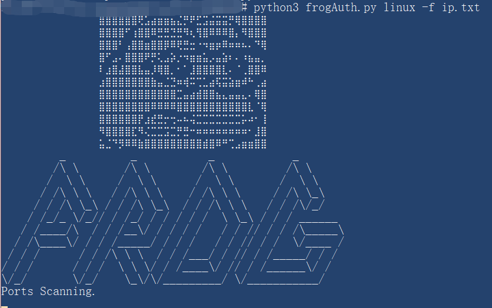

- 🐸Frog For Automatic Scan

- 🐶Doge For Defense Evasion&Offensive Security

- 本系列命名为Frog可能是因为这种生物的寿命长 🐸 🤓 +1s 

- Frog-Auth为Frog系列第二个项目🐸

# 🐸Frog-Auth

Frog-Auth未授权访问检测，采用python3实现，使用subprocess加载[naabu](https://github.com/projectdiscovery/naabu)端口扫描工具，

使用httpx进行二次web服务检测

配合全面的未授权访问pocs以及独特检测框架，支持ip/domain/CIDR输入。

## about

在对大量数据整理分析过后挑选了100+个未授权访问/公开暴露服务对应的高频端口，使用naabu进行端口扫描，

扫描结果会按开放端口情况再进行分类后按需检测，可通过 `--shuffle` 手动打散任务顺序，

poc按组件、端口和风险层级注册，扫描时只调度命中端口的只读检测逻辑，并支持低噪声模式控制并发、速率和HTTP请求频率。

目前有针对以下服务的未授权漏洞检测:

```
redis, mongodb, memcached, zookeeper, Hadoop, mysql, 

ftp, kibana, kong, elasticsearch, CouchDB, docker, 

docker registry api, influxdb, hadoop yarn api, 

jenkins, druid, spark, spark api, tensorboard, jboss

springboot, zabbix, flink, solr, prometheus, alertmanager,

grafana, consul, etcd, kubernetes api, jupyter,

swagger/openapi, nacos, rabbitmq management, jaeger, zipkin
```
## update log
```
2020/11/09

加入httpx针对domain的检测以避免漏过cdn，修复部分判断逻辑错误，

新增zabbix默认密码、solr未授权、flink未授权检测，修改https对应端口

考虑到青蛙头banner在部分字体中会乱码，故删去
```

#### 感谢RabbitMask提供的springboot poc, xray社区的部分未授权访问poc, kingkk的建议, cwkiller的部分未授权访问poc

## 常用命令
```
python3 frogAuth.py linux -f ip.txt

python3 frogAuth.py win -f ip.txt
```
ip.txt按行划分，支持ip/domain/CIDR格式

低噪声/低负载扫描：
```
python3 frogAuth.py linux -f ip.txt --low-noise
```

直接复用已有 `host:port` 结果文件：
```
python3 frogAuth.py linux -m file -f ports.txt
```

常用调优参数：
```
--threads 100        组件检测并发
--timeout 6          单次网络请求超时
--rate 1000          naabu 端口探测速率
--http-rate 0        HTTP请求全局限速，0为不限速
--no-httpx           跳过domain的httpx Web服务补充探测
--output results.txt 结果输出文件，默认覆盖写入
--append             追加写入历史结果
```

## Usage
Linux下会自动为内置 naabu/httpx 二进制补充可执行权限，也可以手动 `chmod +x ports/naabu_linux httpx/httpx_linux`。
```
python3 -m pip install -r requirements.txt

python3 frogAuth.py linux -f ip.txt

```
## 运行截图


## todo
若有好的建议，新的未授权访问poc，程序的bug，欢迎提交issues

## 🚀Star Trend
[](https://starchart.cc/timwhitez/Frog-Auth)


## etc
1. 开源的样本大部分可能已经无法免杀,需要自行修改

2. 我认为基础核心代码的开源能够帮助想学习的人
 
3. 本人从github大佬项目中学到了很多
 
4. 若用本人项目去进行：HW演练/红蓝对抗/APT/黑产/恶意行为/违法行为/割韭菜，等行为，本人概不负责，也与本人无关

5. 本人已不参与大小HW活动的攻击方了，若溯源到timwhite id与本人无关
